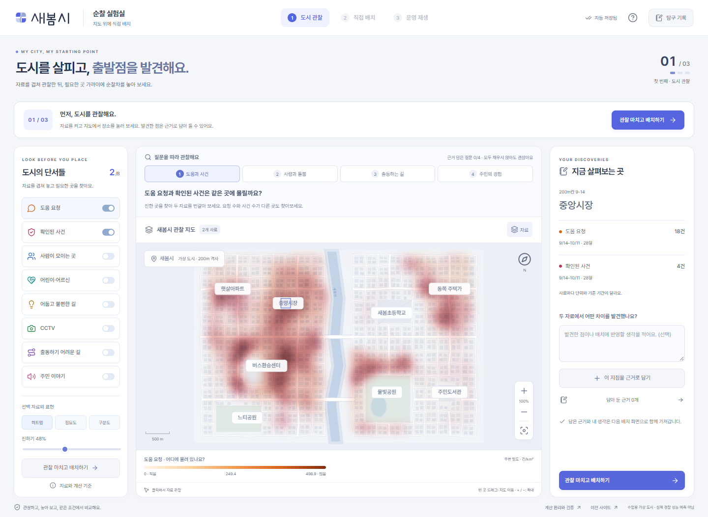

# 새봄시 순찰 실험실

**지도를 읽고, 근거를 모으고, 순찰차 10대의 배치를 비교하는 수업용 웹 앱입니다.**

가상 도시 새봄시의 도움 요청·인구·시설·주민 이야기를 겹쳐 관찰합니다. 도로 위에 순찰차를 배치하면 전담 구역과 순찰 코스가 만들어지고, 같은 일주일의 요청으로 출동·대기·지원·복귀 과정을 비교할 수 있습니다.

React 19 · Vite 7 · 한국어 UI · 별도 서버·지도 API 키 불필요

## 주요 기능

- **도시 관찰:** 8개 자료를 겹쳐 보고 히트맵·점묘도·단계구분도로 수량 자료를 비교합니다. 도로 혼잡과 주민 이야기는 전용 표현으로 표시합니다.
- **근거 수집:** 네 가지 관찰 미션을 따라 장소별 자료와 이유를 최대 16개까지 기록합니다.
- **직접 배치:** 도로를 누르거나 차량을 끌어 10대를 배치하고, 담당 구역과 선택 차량의 순찰 코스를 확인합니다.
- **운영 재생:** 가상 출동 요청 965건을 발생시각 순으로 재생하며 담당차·지원차의 업무와 대기를 살펴봅니다.
- **같은 조건 비교:** 기준 배치와 현재 배치에 동일한 요청·업무 시간을 적용합니다.
- **기록 보관:** 브라우저 자동 저장과 배치·근거 JSON 내보내기/불러오기를 지원합니다.
- **이전 버전 보관:** 이전 정적 사이트를 public/legacy/에 원본 그대로 포함합니다.

## 빠른 시작

Node.js **22.12 이상**이 필요합니다. 이 패키지는 Node.js 24에서 확인했습니다.

저장소를 내려받아 압축을 푼 뒤 package.json이 있는 폴더에서 실행합니다.

~~~sh
npm ci
npm run dev
~~~

브라우저에서 http://127.0.0.1:5176/ 을 엽니다. Windows PowerShell에서 npm.ps1 실행이 제한되면 같은 명령을 npm.cmd ci, npm.cmd run dev로 실행하세요.

~~~sh
npm run verify         # 계산 모형 검사와 검증 JSON 갱신
npm run check:package  # 자료·문서 링크·이전 사이트 무결성 검사
npm run build          # 검사 후 dist/ 생성
npm run preview        # dist/ 로컬 미리보기
~~~

React 앱은 HTTP 서버에서 실행합니다. index.html을 더블클릭해서 여는 방식은 지원하지 않습니다. 처음 의존성을 설치할 때는 인터넷이 필요하며, 설치 후 로컬 실행은 외부 지도 서비스 없이 동작합니다.

## 사용 흐름

1. **도시 관찰:** 자료를 켜고 지도에서 장소를 눌러 관찰 근거를 담습니다.
2. **직접 배치:** ‘관찰 마치고 배치하기’를 누르고 차량 10대를 도로에 놓습니다. 비교할 배치를 기준 배치로 저장할 수 있습니다.
3. **운영 재생:** ‘배치 마치고 운영 재생’을 눌러 시간순 운영과 일주일 결과를 확인합니다.
4. **수정·설명:** 차량 위치를 바꾸고 같은 조건으로 다시 계산해 변화의 이유를 설명합니다.

## 문서

| 문서 | 내용 |
|---|---|
| [학생 사용 안내](docs/USER_GUIDE.md) | 관찰, 배치, 재생, 기록 저장 |
| [교사용 수업 안내](docs/TEACHER_GUIDE.md) | 수업 흐름과 토론·평가 질문 |
| [자료 설명](docs/DATA_DICTIONARY.md) | 가상 자료의 기간, 구조, 레이어, 지표 |
| [계산 모형](docs/SIMULATION_MODEL.md) | 전담 구역, 지원 규칙, 시간·지표의 의미 |
| [개발 안내](docs/DEVELOPMENT.md) | 구조, 실행, 수정, 검사 |
| [GitHub 업로드·배포](docs/GITHUB_AND_DEPLOYMENT.md) | 새 저장소 업로드, Pages 수동 배포 |
| [검증 기록](docs/VALIDATION.md) | 이 패키지에서 실제 확인한 결과 |
| [정리 내역](docs/RELEASE_NOTES.md) | 기준 버전, 포함·제외 파일, 이식 수정 |
| [외부 구성요소·권리](docs/THIRD_PARTY_NOTICES.md) | 글꼴과 패키지 라이선스, 참고 자료 |

## 저장소 구성

~~~text
GitHub_업로드용/
├─ README.md
├─ package.json / package-lock.json
├─ index.html / vite.config.js
├─ src/                       # React 화면·지도·계산 엔진
├─ public/
│  ├─ data/                   # 도시 자료와 검증 결과
│  ├─ brand/ / fonts/         # 로고·글꼴·글꼴 라이선스
│  └─ legacy/                 # 보존한 이전 사이트
├─ scripts/                   # 모형 검사·패키지 검사·회귀 기준
├─ docs/                      # 안내 문서와 실제 화면
└─ .github/workflows/         # 자동 빌드 검사 / 수동 Pages 배포
~~~

GitHub에는 **이 폴더 안의 내용을 저장소 최상위에** 올립니다. README.md와 package.json이 바로 보여야 합니다. node_modules/, dist/, 기존 배포 계정 설정은 업로드하지 않습니다.

## 자료와 해석

도시의 수치·사건·주민 발언은 수업용 가상 자료입니다. 관찰 기간은 2026-09-14~2026-10-11이며, 운영 비교 기간은 2026-10-12~2026-10-18입니다. 전체 요청 1,120건 중 차량 출동이 필요한 965건을 계산합니다.

일반적인 단일 차량 요청은 담당차를 기다리고, 긴급·2대 요청은 지원 규칙을 적용합니다. 이 가정 때문에 일부 구역은 요청이 대기하는 동안 다른 구역 차량은 순찰할 수 있습니다. 계산값은 실제 지역의 위험도나 경찰 성능을 예측하지 않습니다. [모형과 한계](docs/SIMULATION_MODEL.md)를 함께 읽어 주세요.

학습 기록은 사용하는 브라우저에 저장되며 서버로 전송하는 기능은 없습니다. 다른 기기·주소로 옮길 때는 JSON으로 내보낸 뒤 불러오세요. 프로젝트 자체의 이용 허락은 [권리 안내](docs/THIRD_PARTY_NOTICES.md)를 확인하세요.
